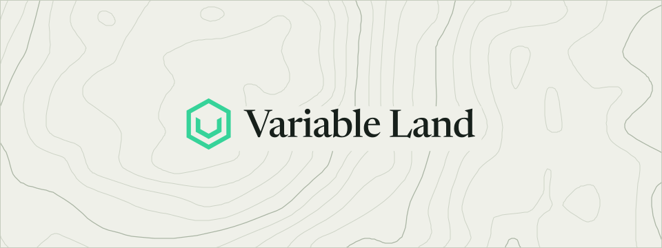

  <picture>
    <source media="(prefers-color-scheme: dark)" srcset=".github/readme/sheet-dark.svg">
    
  </picture>

<h1 align="center">www</h1>

Variable Land's homepage, at variable.land.

[variable.land](https://variable.land) is one static page: a map sheet with the contour lines of an invented land, the Logo on its Summit and the name beside it as a place label. Its tokens, Logo and Map come from Variable Land's brand package, `@variableland/brand`. [Astro](https://astro.build) builds it into `dist/`, and a Worker with no script serves `dist/` as [static assets](https://developers.cloudflare.com/workers/static-assets/).

## Contributing

The [contributing guide](docs/contributing.md) covers issues and pull requests, and the [development guide](docs/development.md) covers setting up the repo and running its checks.

## Repository

| Folder                   | What it holds                                                                          |
| ------------------------ | -------------------------------------------------------------------------------------- |
| [**src/**](src/)         | The page, its images and its styles                                                    |
| [**public/**](public/)   | `robots.txt` and `_headers`, copied as is                                              |
| [**.github/**](.github/) | The workflows and this README's sheet                                                  |
| [**docs/**](docs/)       | The [contributing](docs/contributing.md) and [development](docs/development.md) guides |

## License

[MIT](LICENSE).

  <a href="https://variable.land">&nbsp;&nbsp;Variable Land</a>

